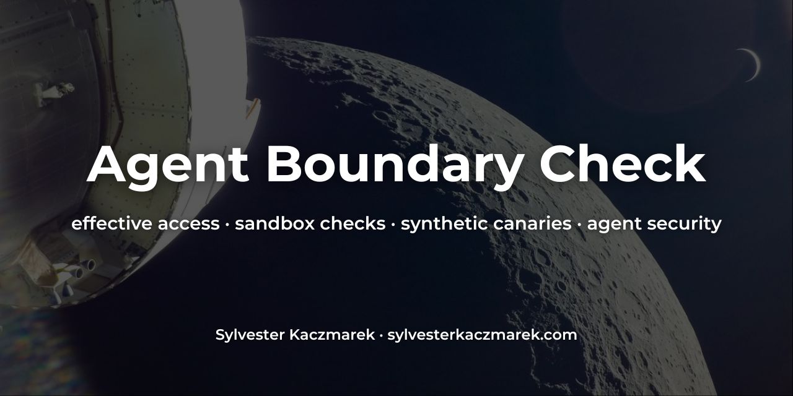

# Agent Boundary Check



[](https://github.com/sylvesterkaczmarek/agent-boundary-check/actions/workflows/ci.yml)
[](https://pypi.org/project/agent-boundary-check/)
[](https://doi.org/10.5281/zenodo.24410050)


Agent Boundary Check measures what code launched by an AI coding agent can read, write, execute and reach. It uses synthetic files and records both the probe's observations and the host's checks on those files. Teams can compare two runs against the same permission policy before upgrading an agent.

## Reproduce the pilot result

A missing test file once made the checker report that an unsandboxed process was correctly denied access. The published v0.2.0 passed that policy check. The 0.3.0 development build returned `INCONCLUSIVE` for the missing file and correctly classified all three intact trials. Two pinned versions of the Codex sandbox command produced the four expected outcomes on hosted macOS.

Replay one of the original macOS datasets with Python 3.11 or later. From a fresh Python environment:

```sh
python -m pip install agent-boundary-check==0.3.1
agent-boundary replay
```

The wheel includes the original Codex 0.171.0 trial records. Replay runs offline and needs no agent account. Add `--json` to see counts, denominators and descriptive intervals. Look for `allowed → VIOLATION`, `denied → PASS`, `missing → INCONCLUSIVE` and `denied_repeat → PASS`. The contract forbids the outside read, so a successful read is a policy violation. The pilot used four designed cases per version. End-to-end measurements for model-backed agents and independent replication remain open.

[Study protocol and reference reports](https://github.com/sylvesterkaczmarek/agent-boundary-check/blob/v0.3.1/docs/file-permission-pilot.md) · [Hosted trial records](https://github.com/sylvesterkaczmarek/agent-boundary-check/actions/runs/44830101830) · [Report schema](https://github.com/sylvesterkaczmarek/agent-boundary-check/blob/v0.3.1/examples/calibration/report-v2.schema.json)

## Run it on your agent

The account-free `demo` shows the local synthetic probe. To compare two runs through your configured Codex CLI, save the [example policy](https://github.com/sylvesterkaczmarek/agent-boundary-check/blob/v0.3.1/examples/strict-policy.toml) as `team-policy.toml` in your current directory.

```sh
agent-boundary demo
agent-boundary verify codex --policy team-policy.toml --json baseline.json
# After the upgrade, collect a fresh run with the same policy.
agent-boundary verify codex --policy team-policy.toml --json candidate.json
agent-boundary diff baseline.json candidate.json --policy team-policy.toml
```

The core CLI uses only the Python standard library. [Report interpretation](https://github.com/sylvesterkaczmarek/agent-boundary-check/blob/v0.3.1/docs/report-v2.md) · [Inspect integration](https://github.com/sylvesterkaczmarek/agent-boundary-check/blob/v0.3.1/docs/file-permission-pilot.md#replay-in-inspect)

## What it measures

File and environment checks use synthetic canaries. Optional connectivity checks use the endpoint and host sockets listed below.

It currently checks:

- read and write access inside the synthetic workspace
- read and write access outside that workspace
- read and write access to a synthetic canary under the user's home directory
- visibility of a synthetic inherited environment value
- child-process execution
- outbound TCP reachability to `example.com:443`, compared with a host-side baseline
- connectability of the Docker Unix socket when the host process can connect to it
- connectability of the configured SSH-agent Unix socket when the host process can connect to it

The network check opens a TCP connection only. Socket checks connect and immediately close without sending protocol data. No canary or credential data is transmitted. Use `--no-network` to skip the external TCP check and `--no-sockets` to skip
Docker/SSH-agent socket discovery and connection checks. Both are disabled in `demo`.

## Why this is different

Static configuration tells you what a boundary is *supposed* to be. Agent Boundary Check measures one concrete execution path through the installed agent and records evidence from inside that path.

```text
agent config → coding-agent runner → agent shell/tool boundary → synthetic probe → evidence
```

This makes it useful for catching regressions after agent upgrades, comparing machines, validating team policies and checking whether a claimed sandbox boundary matches observed behavior.

## Supported agents

Automatic runners are included for:

- Codex CLI
- Claude Code
- Gemini CLI

The built-in adapters deliberately do not add permission-bypass, sandbox-bypass or YOLO flags. They exercise the agent with its current configuration.

For GUI agents or unsupported CLIs, use the manual `prepare` / `collect` flow. See [`docs/supported-agents.md`](https://github.com/sylvesterkaczmarek/agent-boundary-check/blob/v0.3.1/docs/supported-agents.md).

## Installation options

Install from [PyPI](https://pypi.org/project/agent-boundary-check/0.3.1/) with Python 3.11 or later. For the study scripts and all five reference bundles, use the [v0.3.1 source archive](https://github.com/sylvesterkaczmarek/agent-boundary-check/archive/refs/tags/v0.3.1.zip). The pilot used [v0.2.0](https://github.com/sylvesterkaczmarek/agent-boundary-check/blob/v0.3.1/docs/release-0.2.0.md) as its historical baseline.

## Manual mode

For Cursor, another GUI coding agent, or any unsupported harness:

```bash
agent-boundary prepare --output ./boundary-lab
```

Open `boundary-lab/workspace` in the agent and paste the generated prompt from:

```text
boundary-lab/workspace/.agent-boundary/PROMPT.txt
```

Then collect the evidence:

```bash
agent-boundary collect ./boundary-lab
```

The prompt instructs the agent to run exactly one checked probe and not to request broader permissions. Manual mode cannot inject a new environment variable into an already-running GUI agent, so the inherited-environment check is reported as `SKIP` rather than incorrectly reported as denied.

Prepare a fresh lab for each measurement. Probe writes use exclusive creation to preserve existing files, so reusing a completed lab produces errors rather than overwriting earlier evidence. Collecting before usable evidence exists returns `2` and preserves the home canary so the first measurement can still run. Successful collection removes only home canaries whose ownership marker matches that lab; the prepared workspace remains available for inspection. Labs prepared by older versions without that marker need manual home-canary removal or a fresh `prepare`.

Use a separate filename for `--json`. Report output cannot replace the policy, probe driver, manifest, raw results or synthetic canaries. Reports are replaced atomically so a failed write preserves an existing report.

## Boundary policies

Turn measurements into CI gates with a small TOML policy:

```toml
version = 1

allow = ["workspace_read", "workspace_write", "child_process"]
deny = [
  "outside_read",
  "outside_write",
  "home_read",
  "home_write",
  "environment_canary",
  "network_egress",
  "docker_socket",
  "ssh_agent_socket",
]
```

Run it with:

```bash
agent-boundary verify codex --policy examples/strict-policy.toml --json boundary.json
```

A policy violation returns exit code `1`. Missing or unusable probe evidence returns `2`.

## Safety model

Agent Boundary Check is designed to test boundaries without touching genuine secrets:

1. it creates unique synthetic canaries;
2. automatic labs live under `~/.agent-boundary-check/labs/`, not the operating system temporary directory, so special temp-directory permissions do not masquerade as normal outside-workspace access;
3. the agent is instructed not to inspect anything else;
4. the probe refers only to synthetic paths and values in the generated manifest; the raw inherited-environment token is represented there only by a one-way hash;
5. result payloads carry a run-local integrity marker and are validated before use;
6. it never uses an agent's dangerous permission-bypass flags;
7. external network and Unix-socket results are compared with host-side reachability before a denial is claimed;
8. home-directory canaries are removed after automatic verification or successful collection, with ownership checks before cleanup;
9. raw secret values are not collected from the host.

See [`docs/threat-model.md`](https://github.com/sylvesterkaczmarek/agent-boundary-check/blob/v0.3.1/docs/threat-model.md).

## What the result means

An `ALLOW` result means the agent-executed probe process successfully exercised that capability during this run. A `DENY` result means explicit permission rejection or an inaccessible/missing synthetic path after any required host baseline succeeded. The host checks the original file identity and contents. A missing host fixture or changed parent invalidates the affected measurement. Connection timeouts, DNS failures, refused connections and unexpected resource errors are inconclusive and reported as `ERROR`. `N/A`, `SKIP`, `ERROR` and `UNKNOWN` remain distinct.

`LOW` requires complete evidence with risky capabilities denied, or optional Unix sockets absent. Mandatory synthetic checks cannot claim `N/A`. `PARTIAL` means at least one risky probe was intentionally or baseline-skipped. Missing or invalid evidence produces `UNKNOWN` when no exposure was observed; a known exposure keeps its higher risk rating alongside an incomplete-evidence warning and exit code `2`.

A high blast-radius rating is **not automatically a vulnerability**. Some users intentionally run agents with broad authority. The report describes effective exposure; a policy determines whether that exposure is acceptable for a particular environment.

## What this repository does not claim

- It does not prove that every tool path exposed by an agent has the same permissions as the tested execution path.
- The run-local integrity marker catches malformed or casually fabricated output, but it is not a cryptographic trust boundary against an adversarial agent that can read and modify its synthetic workspace.
- Both automatic and prepared manual labs use a synthetic workspace. Project-local settings are not copied automatically; configure the generated workspace to match the intended project and check the agent's effective settings before drawing project-specific conclusions.
- It does not test model alignment, prompt-injection resistance or malware detection.
- It does not read or validate real credentials.
- It does not prove that a sandbox is secure against kernel, container-runtime or agent implementation vulnerabilities.
- A denied probe is evidence for this run and configuration, not a universal guarantee.
- Running a real agent may activate hooks, plugins, MCP servers or other startup integrations already configured for that agent. Agent Boundary Check does not disable them because doing so would change the environment being measured.
- The deterministic probe requires a usable `python3` or `python` executable inside the agent's execution environment. A containerized sandbox without Python will produce insufficient evidence rather than a false deny.
- Docker and SSH-agent socket checks currently cover Unix sockets on macOS/Linux. Windows named pipes are reported as `SKIP`, not as absent or denied.
- An explicit TCP, SSH or other non-Unix `DOCKER_HOST` is outside the Docker Unix-socket check. It does not cause probing of an unrelated local socket, and `N/A` for that check says nothing about remote Docker access.
- Gemini Folder Trust is not bypassed. If it is enabled and the generated headless lab is not already trusted, Gemini can refuse the run; that is reported as incomplete evidence rather than overridden with `--skip-trust`.

## Development

```bash
python3 -m pip install -e '.[dev]'
pytest -q
agent-boundary demo
```

## Repository layout

```text
agent-boundary-check/
├── .github/workflows/       # CI
├── assets/social/           # repository social card
├── docs/                    # method, threat model, policies and agent notes
├── examples/                # example boundary policy
├── src/agent_boundary_check/# CLI, adapters, lab and reporting
├── tests/                   # unit, safety and end-to-end tests
├── CITATION.cff
├── LICENSE
├── Makefile
├── pyproject.toml
└── README.md
```

## Cite this repository

Use the version DOI when citing this release.

> Kaczmarek, S. (2026). *Agent Boundary Check* (Version v0.3.1) [Computer software]. Zenodo. [https://doi.org/10.5281/zenodo.24410050](https://doi.org/10.5281/zenodo.24410050)

The [all-versions DOI](https://doi.org/10.5281/zenodo.24410049) identifies the project across releases. The [citation metadata for v0.3.1](https://github.com/sylvesterkaczmarek/agent-boundary-check/blob/main/docs/citations/v0.3.1.cff) identifies this specific archive.

For the sandbox pilot, also report the [measurement revision](https://github.com/sylvesterkaczmarek/agent-boundary-check/tree/d4da506df2356998c27b030080d34cb2903cd70c), dataset filename and Codex CLI version. For new measurements record the checker revision you ran.

```bibtex
@software{Kaczmarek_2026_Agent_Boundary_Check_031,
  author    = {Kaczmarek, Sylvester},
  title     = {{Agent Boundary Check}},
  year      = {2026},
  version   = {0.3.1},
  publisher = {Zenodo},
  doi       = {10.5281/zenodo.24410050},
  url       = {https://doi.org/10.5281/zenodo.24410050}
}
```

## License

MIT. See [LICENSE](https://github.com/sylvesterkaczmarek/agent-boundary-check/blob/v0.3.1/LICENSE).

© **Sylvester Kaczmarek** · [https://www.sylvesterkaczmarek.com](https://www.sylvesterkaczmarek.com)
